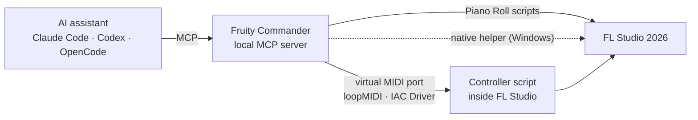

<p align="center">
  
</p>

<h1 align="center">Fruity Commander 2000</h1>

<p align="center">
  <b>Make music in FL Studio by asking your AI assistant.</b><br>
  Editable notes, instruments, mixer effects and Automation Clips, written into your own project.
</p>

<p align="center">
  
  
  
  
  
</p>

<p align="center">
  <a href="#what-you-can-ask-for">Examples</a> ·
  <a href="#features">Features</a> ·
  <a href="#how-it-works">How it works</a> ·
  <a href="#get-started">Get started</a> ·
  <a href="#status">Status</a> ·
  <a href="#development">Development</a>
</p>

---

Fruity Commander 2000 is an [MCP](https://modelcontextprotocol.io) server and agent
plugin that lets an AI assistant work inside a running FL Studio project. You
describe the music; the assistant writes it into FL as ordinary material you can
keep editing: Piano Roll notes, loaded instruments, mixer effects, native
Automation Clips and Playlist arrangement. Nothing is bounced to audio behind your
back. Open the Piano Roll and every note is there to tweak.

## What you can ask for

> *"Make an 8-bar ambient chord progression on a new pad and put it at bar 1."*
>
> *"Move the melody in bars 5–8 up an octave and leave everything else alone."*
>
> *"Add a slow filter sweep over the chorus as an Automation Clip."*
>
> *"Put Reeverb 2 on a send and route the lead and the pads to it."*
>
> *"Find a dusty drum loop in my Splice library and drop it on track 6."*
>
> *"Play it from the top, then save it as Night Drive v2."*

The assistant inspects your project first, uses the channels and patterns that are
actually there, and reads back what FL did after every change.

## Features

| | Windows | macOS *(preview)* |
| --- | :---: | :---: |
| Create, read and revise Piano Roll notes | ✅ | ✅ ¹ |
| Tempo, transport, mixer, sends and plugin parameters | ✅ | ✅ |
| Load instruments | ✅ installed presets, VST2 state | ✅ by name |
| Load mixer effects | ✅ into a chosen slot | ✅ by name |
| Native Automation Clips: create and edit curves | ✅ | 🔜 |
| Place patterns and audio in the Playlist | ✅ | 🔜 |
| Import WAVs and owned Splice sounds | ✅ | 🔜 |
| Save and Save As, with the file write verified | ✅ | 🔜 save with ⌘S |

¹ On a Mac you click **Postfader Apply** in the Piano Roll once each time FL starts;
the assistant tells you when. Everything after that is automatic.

## How it works



- **One local MCP server.** Your assistant calls defined operations with checked
  results. It never works by taking screenshots and clicking around your screen.
- **A controller script inside FL** handles mixer, transport, channels and plugin
  parameters over a virtual MIDI port: loopMIDI on Windows, the built-in IAC
  Driver on macOS.
- **Notes go through FL's own Piano Roll scripting**, and every run returns a signed
  receipt. The assistant reports what FL actually stored, not what it asked for.
- **On Windows, a small native helper** adds what FL's public scripting can't do:
  Automation Clips, Playlist placement, sample import, preset loading and Save As.
  It checks the exact FL build first and refuses an unknown build instead of guessing.
- **Careful by default.** Writes stay off until your request needs them, edits never
  auto-save, and an uncertain result is inspected rather than silently retried.

## Get started

You need **FL Studio 2026** (26.1.3 build 5336 or newer), Python with
[uv](https://docs.astral.sh/uv/), and an MCP-capable assistant such as Claude Code
(desktop app or CLI), Codex or OpenCode.

| | Windows | macOS (preview) |
| --- | --- | --- |
| Guide | [SETUP.md](SETUP.md) | [SETUP-macOS.md](SETUP-macOS.md) |
| Python | 3.13 + MSVC Build Tools (native helper) | 3.12 |
| Virtual MIDI | [loopMIDI](https://www.tobias-erichsen.de/software/loopmidi.html) | IAC Driver (built in) |
| Owned operations | Qualified on FL 26.1.6 build 5639 | Not yet tested on a real Mac |

The guides walk through the same four steps:

1. **Install** the Python runtime from this repository.
2. **Connect FL** with a virtual MIDI port and the controller script.
3. **Add the plugin** to Claude Code or Codex. The packager builds a bundle with
   the workflow skill, the icon and your installation's paths.
4. **Ask for music.** A built-in setup check tells you what still needs attention.


The plugin appears in your assistant with this icon. It bundles a workflow skill
that teaches the assistant to inspect before editing and to keep "edited", "played"
and "saved" apart.
<br clear="left">

## Status

**Windows.** The full workflow runs live on FL Studio Producer Edition 26.1.6
build 5639: notes, instrument loading, effects and sends, native Automation Clips,
Playlist placement, sample import, playback, and save and reopen. Codex and OpenCode
have completed real editing sessions; Claude Code has passed read-only checks so far.
Mixer, transport and parameter control work on any supported FL 2026 build. Owned
operations check for the exact qualified engine, so a new FL build needs
qualification before they run.

**macOS.** A preview that has not yet run on a real Mac. If you have one, follow
[SETUP-macOS.md](SETUP-macOS.md), run its read-only probe, and
[open an issue](https://github.com/ossianravn/fruity-commander-2000/issues) with the
results. That evidence decides how the Windows-only features come to the Mac.

**Not yet.** Automatic tempo fitting for samples, collecting samples into the project
folder, curve shapes other than linear, and a signed one-click installer.

## Development

Run the test suite from the repository root (`.venv/bin/python` on macOS):

```powershell
.\.venv\Scripts\python.exe -B -m unittest discover -s tests -v
```

| Path | Contents |
| --- | --- |
| [`scripts/`](scripts) | MCP tools and host routes (`windows_*`, `mac_*`), setup, packaging and checks |
| [`native/`](native) | The Windows native helper (C++) |
| [`.agents/skills/fruity-commander/`](.agents/skills/fruity-commander) | Agent workflow skill and references |
| [`tests/`](tests) | Unit and contract tests |

Each maintained source file is kept to at most 300 lines.

## Credits

- Built on [PostFader](https://github.com/synopsys0/postfader-fl-studio-mcp)
  (Apache-2.0), pinned by revision in [`requirements.txt`](requirements.txt). It
  supplies the MCP base, the MIDI bridge and many of the tools.
- Native operation design was informed by
  [FruityLink](https://github.com/Realynx/FL-Automation) (MIT).

Fruity Commander 2000 is an independent project, not affiliated with or endorsed by
Image-Line. FL Studio is a trademark of Image-Line Software.
